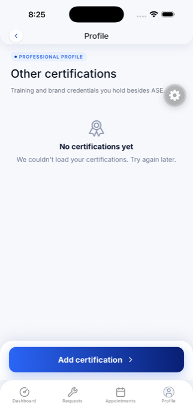
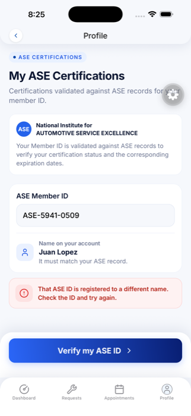
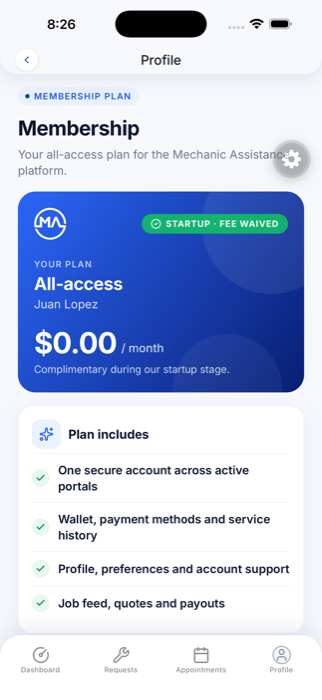
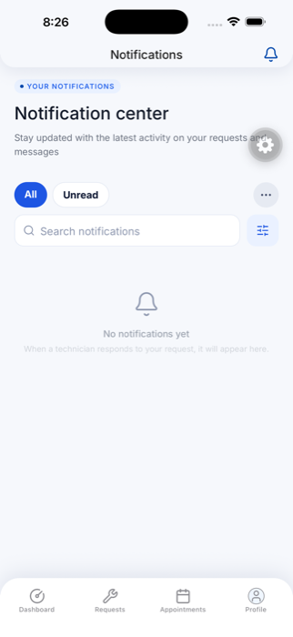

# Para Alejandro: qué revisar en el backend (23-nov-2026)

**De:** app mobile · **Detalle completo de cada punto:** [backlog-backend.md](backlog-backend.md) (misma letra de cada ítem; cada uno trae "cómo lo verificamos").
Orden pensado para trabajar de arriba hacia abajo: lo que hoy **falla en producción** primero, después lo que **cambia el contrato**, después lo nuevo.

---

## 1. Fallan hoy en producción (bloquean pantallas de la app)

| # | Qué | Síntoma | Pedido |
|---|---|---|---|
| **AJ** | Gateway sin ruta `/api/mechanic-certifications` | Guardar una certificación → `403 "Call this through the API gateway (/api/...)"` | Rutear el prefijo a `USERS_SERVICE_URL` (junto a `/api/mechanic-documents`) y desplegar el gateway |
| **Y** | `GET /api/reviews/me` | Mismo 403 con sesión válida; las reseñas del perfil no cargan (el README de appointments dice que existe; la tabla del gateway no lo lista) | Rutear `/api/reviews` y confirmar con una sesión real |
| **AO** | Token de registro (30 min) en `POST /api/ase-membership/verify` | `403 "Token not valid for this route"`: el técnico no puede validar su ASE ID durante el alta | Agregar `verify` y `GET /api/ase-membership/lookup/:aseId` a las rutas del alcance `signup`. Hoy la app lo explica y deja verificar después desde el perfil |

## 2. Nuevo de esta semana

| # | Qué | Pedido |
|---|---|---|
| **AN** | **Membership plan** (perfil → Account). La pantalla ya existe con datos simulados | `GET /api/membership/me`, `POST /api/membership/promo-code`, `PATCH /api/membership/me`, `POST /api/membership/cancel` (formas exactas en el backlog). Rutear `/api/membership` en el gateway (acordate de AJ) y avisar por notificación antes de cualquier cambio de plan o precio |

## 3. Campos y errores que la app ya espera (cambios chicos de contrato)

| # | Endpoint | Qué agregar |
|---|---|---|
| **AK** | `POST /api/assistance/summaries` y `GET /marketplace/requests` | `refCode` (hoy se muestra el inicio del id) |
| **AE** | `GET /marketplace/requests[/:id]` | `refCode` en la vista reducida del prestador |
| **AL** | `GET /marketplace/requests` | `createdAt` (ISO) y `myOffer.createdAt` |
| **E** | `GET /api/assistance` | `offerExpiresAt` |
| **AI** | `POST …/client-review` y `…/review` | Aceptar `experienceTags: string[]` (array en ambos) y devolverlo. **Antes de endurecer el DTO, desplegar el backend**: con `forbidNonWhitelisted` una app vieja recibe 400 |
| **AM** | Eventos y `GET /appointments` | Emitir un evento al cambiar de paso de la visita (hoy la app sondea cada 15 s) y devolver siempre `vehicleCondition` |
| **AG** | `GET /api/assistance/:id/offer` | No enviar `displayName`, `profileImage`, `initials` mientras la oferta no esté aceptada (hoy se ven en el tráfico aunque la app los oculte) |
| **AH** | chat-service | `canWrite: false` y rechazo de mensajes en `awaiting_confirmation` |
| **AF** | Notificaciones | `new_request` solo como push, sin guardarla en la bandeja |
| **S** | Solicitudes | Evento cuando otro técnico toma la solicitud; 409 `request_unavailable` al ofertar sobre una ya tomada; documentar qué ve el técnico que no ganó |
| **R** | Catálogo | Issue "Other" cotizable y `customIssue` (≤ 200) en `POST /api/assistance` |
| **AC** | Citas | Ocultar una cita cancelada por usuario (`POST/DELETE /api/appointments/:id/hide`) |
| **AP** | `POST /appointments/:id/on-site/diagnostic` | Aceptar el diagnóstico sin fotos de patente y tablero cuando el técnico elige seguir sin ellas (`photosSkipped: true`) y dejarlo marcado en la visita |

## 4. Funciones nuevas (decisión de producto o capacidad)

- **X** precio de videollamadas agendadas con asignador de descuento en el Hub (hay que definir porcentaje y quién lo financia) · **T** confirmar 60 min de punta a punta · **L** transcripción en la cuenta de Daily · **V** traducción de subtítulos · **W** agente de cuidado del vehículo · **AB** textos de push más completos.
- **Hub / auth:** pantalla de revisión de certificaciones, permisos `certifications.read.any` y `certifications.verify.any` en `SEEDED_PERMISSIONS`, push 30 días antes del vencimiento.

## 5. Preguntas puntuales (respondé con un sí/no o un dato)

1. **Notificaciones:** hoy el backend solo marca **todas** como leídas. ¿Se puede agregar marcar **una**? (la app ya tiene el menú; falta el endpoint).
2. **Notas del trabajo (`workNotes`):** ahora cada entrada lleva título y descripción en un solo texto. ¿Cuál es el largo máximo que acepta el campo?
3. **Wallet / tarjeta:** un dueño nuevo agregó su tarjeta durante el pedido; confirmen que `POST /api/payment-methods/me` la guarda siempre y que el pago aparece en `/api/payments/me/history` cuando se confirma la oferta (el pago nace en esa confirmación, no al crear el pedido).
4. **Documentación (AD):** actualizar el repo de análisis con lo que se vaya cerrando.

## 6. Confirmar que está desplegado (figuran como hechos)

AA, B, N, O (precio, duración y zona horaria de videollamadas) · Q, P/U, J, K, M (consentimientos, transcripción, presencia, ganancia por extensión, push) · Z (otras certificaciones) · A, C, D, F, G, H, I. La lista con "cómo lo confirmamos" está en el backlog; la idea es probarlo contra producción, no contra el README (ya pasó que algo figuraba como hecho y producción lo rechazaba).

## Capturas de dónde aplican (app técnico, build actual)

Pantallas capturadas en el simulador con una cuenta de técnico sin datos. Las que necesitan pedidos, reseñas o citas reales no se pudieron capturar.

**AJ — Other certifications.** Con el gateway sin la ruta, la pantalla no puede cargar ni guardar (mensaje "We couldn't load your certifications"). Es lo que se ve hoy.

**AO — ASE Certifications.** El botón "Verify my ASE ID" consulta ASE; en el registro, con el token de alta, el mismo llamado da 403. Se ve aquí en el perfil, donde el técnico ya tiene sesión completa. El nombre de la cuenta tiene que coincidir con el del registro ASE.

**AN — Membership plan.** Pantalla con datos simulados: tarjeta del plan, estado, "Plan includes", Billing y "Cancel plan" más abajo. Es lo que los endpoints de AN van a alimentar.

**AF — Notificaciones.** Bandeja donde hoy se acumulan los `new_request` (aquí vacía en esta cuenta). Tiene el menú de acciones (marcar todas, borrar todas); falta el endpoint para marcar una sola.

**Sin captura (necesitan datos reales):** Y (estrellas del perfil con reseñas), AK/AE/AL/E (tarjetas de Requests y códigos al pie del wallet), AM (línea de tiempo del dueño), AG (oferta con foto borrosa), AH (chat cerrado), S, R y AC. Si Alejandro necesita verlas, con una cuenta con pedidos y citas se capturan en minutos.

---

## 7. Cuando termines un punto

Avisá la letra (ej. "AJ listo"). La app lo verifica contra producción y, si hace falta, quita el parche que tiene en el cliente (S, AF y AM tienen uno).
